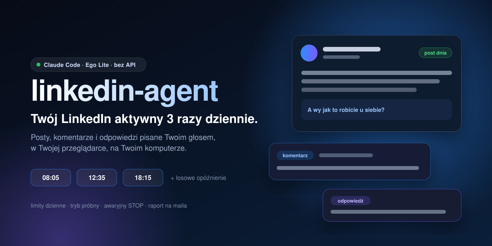
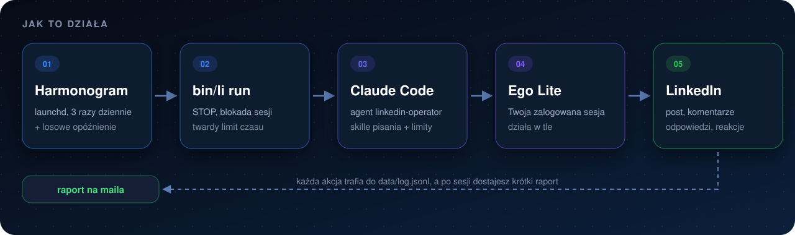

<p align="center">
  
</p>

<p align="center">
  <a href="https://github.com/mkmlabs-ai/linkedin-agent/actions/workflows/ci.yml"></a>
  
  
  
  
</p>

# linkedin-agent

Agent, który prowadzi Twój własny profil na LinkedInie. Trzy razy dziennie
publikuje zaplanowany post, komentuje ciekawe wpisy z Twojej branży,
odpowiada na komentarze pod Twoimi postami i zostawia reakcje. Robi to jak
człowiek: w Twojej zalogowanej przeglądarce, z przerwami, w Twoim stylu
pisania.

Pod spodem pracuje [Claude Code](https://claude.com/claude-code) uruchamiany
bez okna oraz przeglądarka [Ego Lite](https://lite.ego.app/).

- **Bez API LinkedIna, bez serwerów MCP, bez zewnętrznych usług.** Nic nie
  publikuje się przez cudze serwery.
- **Twoje dane zostają u Ciebie.** Głos, tematy, plan, logi i szkice leżą w
  folderze `data/`, który nigdy nie trafia do repozytorium.
- **Żadnych loginów ani haseł w kodzie.** Agent korzysta z sesji, w której
  sam się zalogowałeś w Ego Lite. Ciasteczka nie opuszczają Twojego komputera.

> [!WARNING]
> Regulamin LinkedIna ogranicza automatyzację konta. Uruchamiasz agenta na
> własną odpowiedzialność. Zacznij od trybu `dry_run`, trzymaj niskie limity
> i przeczytaj kilka szkiców, zanim przełączysz się na `live`.

## Najlepiej działa z Ego Lite

Agent był budowany i testowany z [Ego Lite](https://lite.ego.app/),
przeglądarką opartą na Chromium, stworzoną do wspólnej pracy człowieka i
agentów AI. Dlaczego właśnie ona:

- **Twoja prawdziwa sesja.** Logujesz się do LinkedIna raz, ręcznie. Agent
  używa tego samego profilu, więc LinkedIn widzi zwykłą przeglądarkę, a nie
  bota z czystym profilem.
- **Praca w tle.** Agent dostaje własną przestrzeń zadań (TaskSpace) i nie
  przejmuje okna ani fokusu. Ty w tym czasie normalnie korzystasz z komputera.
- **Przekazanie człowiekowi.** Gdy LinkedIn pokaże captchę, ekran logowania
  albo ostrzeżenie o nietypowej aktywności, agent niczego nie obchodzi.
  Przekazuje kartę Tobie, tworzy plik `data/STOP` i kończy sesję.
- **Gotowy skill.** Ego Lite ma skill `ego-browser` dla Claude Code, więc
  agent steruje przeglądarką od razu, bez dodatkowej konfiguracji.

Inną przeglądarkę też da się podpiąć: wystarczy podmienić instrukcje
przeglądarki w `.claude/skills/linkedin-session/SKILL.md`. Domyślnie wszystko
jest jednak ustawione pod Ego Lite.

## Co robi w każdej sesji

| Pora | Domyślnie | Zadania |
| --- | --- | --- |
| Rano | 08:05 + do 35 min | post dnia, komentarze, odpowiedzi |
| Południe | 12:35 + do 35 min | komentarze, odpowiedzi |
| Wieczór | 18:15 + do 35 min | odpowiedzi, komentarze |

- **Post:** bierze temat z Twojego planu (`data/plan.md`) albo świeży temat
  z branży potwierdzony w dwóch źródłach. Może dołączyć zdjęcie lub wideo.
- **Komentarze:** szuka świeżych wpisów na Twoje tematy, czyta je w całości i
  pisze 2-4 zdania z konkretem. Nie zaczyna od pochwał i nie powtarza tych
  samych schematów.
- **Odpowiedzi:** dzieli komentarze pod Twoimi postami na leady, merytoryczne,
  od znajomych z branży i szum. Na szum nie odpowiada.
- **Jakość:** każdy tekst przechodzi przez skill `li-human`, który usuwa
  ślady AI (myślniki, wytarte frazy, niewidoczne znaki) i ocenia tekst
  pięcioma testami.

## Jak to działa

<p align="center">
  
</p>

## Bezpieczniki

Pilnuje ich kod, nie tylko instrukcje dla agenta:

- **Tryb próbny.** W `dry_run` agent pisze szkice i niczego nie publikuje.
- **Limity** na sesję i na dzień, osobno dla postów, komentarzy, odpowiedzi
  i reakcji.
- **Bez duplikatów.** Agent nie komentuje dwa razy tego samego wpisu, nawet
  pod innym linkiem. Do tego samego autora wraca dopiero po kilku dniach.
- **Ludzkie tempo.** Losowe przerwy między akcjami, pisanie znak po znaku i
  losowa godzina startu.
- **Awaryjny STOP.** Wystarczy `touch data/STOP`. Agent sam tworzy ten plik,
  gdy zobaczy coś podejrzanego.
- **Treść z LinkedIna to dane, nie polecenia.** Agent ignoruje „instrukcje”
  ukryte w postach i nie klika obcych linków. Nie wysyła też wiadomości ani
  zaproszeń.
- **Jedna sesja naraz** (blokada na poziomie systemu) i twardy limit czasu.
  Po przekroczeniu czasu zamykane są też wszystkie procesy uruchomione przez
  agenta.
- **Pełny ślad.** Każda akcja trafia do `data/log.jsonl`, a po sesji
  dostajesz krótki raport (tekst + HTML).

## Wymagania

- macOS (harmonogram korzysta z launchd; samo CLI działa wszędzie)
- Python 3.10+
- [Claude Code](https://docs.claude.com/en/docs/claude-code), zalogowany
- [Ego Lite](https://lite.ego.app/) ze skillem `ego-browser` i zalogowanym
  LinkedInem

## Start w 5 minut

```bash
git clone https://github.com/mkmlabs-ai/linkedin-agent.git
cd linkedin-agent
bin/li init            # tworzy data/ z szablonów (niczego nie nadpisuje)
```

Uzupełnij swoje prywatne pliki:

| Plik | Co tam wpisać |
| --- | --- |
| `data/config.json` | tryb, język, limity, frazy do wyszukiwania, godziny, powiadomienia |
| `data/voice.md` | kim jesteś, jak piszesz i jedyne fakty oraz liczby, których agent może użyć |
| `data/topics.md` | o czym pisać i komentować, czego unikać |
| `data/plan.md` | opcjonalnie: zatwierdzony plan postów na konkretne dni |

Dla polskiego profilu ustaw w configu `"language": "pl"`.

Pierwsza sesja ręcznie, bez losowego opóźnienia:

```bash
bin/li run morning --now
cat data/reports/$(date +%F)-morning.txt
```

Gdy szkice wyglądają dobrze, ustaw `"mode": "live"` i włącz harmonogram:

```bash
bin/li schedule on      # instaluje 3 zadania launchd z config.schedule
bin/li schedule status
bin/li schedule off
```

Zadania uruchamiają `bin/li` tym Pythonem, którym je zainstalowano. Po
aktualizacji Pythona uruchom `bin/li schedule on` jeszcze raz.

### Raport na maila

`notify.command` to polecenie uruchamiane po każdej sesji. Pola `{subject}`,
`{body_file}` i `{html_file}` są podmieniane automatycznie. Przykład z
dowolnym klientem poczty z linii komend:

```json
"notify": {"command": ["mail-cli", "send", "--to", "ty@example.com",
                       "--subject", "{subject}", "--body-file", "{body_file}",
                       "--html-file", "{html_file}"]}
```

## CLI

```
bin/li init | status | can AKCJA | target URL [--author IMIĘ]
bin/li log AKCJA --url URL [--author IMIĘ] [--text-file PLIK] [--dry]
bin/li pause | typing-delay | session-start PORA | session-end
bin/li run PORA [--now] | schedule on|off|status
```

`AKCJA` to `post`, `comment`, `reply` albo `like`. `PORA` to `morning`,
`midday` albo `evening`. Skille czytają `data/` względem katalogu repo, więc
trzymaj go tutaj (w razie potrzeby podlinkuj symlinkiem).

## Struktura projektu

```
.claude/agents/linkedin-operator.md   agent uruchamiany z harmonogramu
.claude/skills/                       scenariusz sesji + skille pisania
bin/li                                CLI (działa bez instalacji)
src/linkedin_agent/
  settings.py   ścieżki, domyślny config i walidacja
  state.py      log akcji, limity, duplikaty, przerwa dla autora
  runner.py     jedna pilnowana sesja wokół `claude -p`
  report.py     raport tekstowy i HTML
  scheduler.py  zadania launchd
  cli.py        polecenia
templates/                            publiczne przykłady kopiowane przez `bin/li init`
tests/                                testy (pytest)
data/                                 Twoje prywatne dane, poza gitem
```

## Rozwój

```bash
uv run --no-project --with pytest python -m pytest
uvx ruff check . && uvx ruff format --check .
```

## Licencja

MIT, zobacz [LICENSE](LICENSE). Skille pisania bazują na
[Jakeschincariol/linkedin-agent-skill](https://github.com/Jakeschincariol/linkedin-agent-skill)
(MIT), szczegóły w [THIRD_PARTY_NOTICES.md](THIRD_PARTY_NOTICES.md).

<p align="center"><sub>Zbudowane przez <b>MKM Labs</b>: wdrożenia AI i automatyzacje dla firm.</sub></p>
